# LAPORAN PRAKTIKUM 5 — JAVASCRIPT DASAR DAN MANIPULASI HTML

## Identitas Mahasiswa
- Nama: Amelia Futri
- NIM: 312510348
- Program Studi: Teknik Informatika
- Mata Kuliah: Pemrograman Web
- Praktikum: Praktikum 5 — JavaScript Dasar dan Manipulasi HTML

## A. Tujuan Praktikum
1. Memahami sintaks dasar JavaScript dan cara menghubungkannya dengan HTML.
2. Menggunakan variabel, tipe data, operator, percabangan, perulangan, dan function.
3. Menampilkan informasi melalui Console, alert, prompt, dan elemen HTML.
4. Mengubah konten serta gaya elemen HTML menggunakan JavaScript.
5. Membuat interaksi sederhana dan validasi input pada form.

## B. Dasar Teori
JavaScript adalah bahasa pemrograman yang digunakan untuk membuat halaman web lebih interaktif. JavaScript dapat mengubah isi HTML, atribut, gaya CSS, serta merespons tindakan pengguna. Kode dapat ditulis di dalam tag `script` atau disimpan pada berkas eksternal berekstensi `.js`.

Beberapa konsep yang digunakan:
- `let` digunakan untuk variabel yang nilainya dapat diubah, sedangkan `const` digunakan ketika variabel tidak perlu ditetapkan ulang.
- Tipe data umum meliputi string, number, boolean, undefined, dan null.
- Operator digunakan untuk melakukan perhitungan atau membandingkan nilai.
- `if-else` dan `switch` digunakan untuk memilih tindakan berdasarkan kondisi.
- Perulangan menjalankan instruksi berulang kali.
- Function mengelompokkan instruksi agar dapat digunakan kembali.
- DOM (Document Object Model) memungkinkan JavaScript memilih dan mengubah elemen HTML.

## C. Persiapan Praktikum
1. Membuat folder kerja bernama `lab5_javascript`.
2. Membuat berkas `index.html` dan `script.js`.
3. Menghubungkan `script.js` dengan HTML menggunakan tag `script`.
4. Membuka `index.html` melalui browser.
5. Membuka Developer Tools → Console untuk memeriksa keluaran program.
6. Menjalankan setiap latihan dan mencatat hasilnya.

## D. Langkah Kerja dan Hasil Praktikum

### Latihan 1 — Menampilkan Output
**Langkah:** JavaScript mengubah teks elemen dengan ID `pesan` menjadi “Hello World” dan menampilkan teks yang sama pada Console.

**Hasil:** Tulisan “Hello World” muncul pada halaman web dan pesan juga tercatat di Console.

**Penjelasan:** `textContent` mengubah teks pada elemen HTML, sedangkan `console.log()` menampilkan informasi pada Console browser.


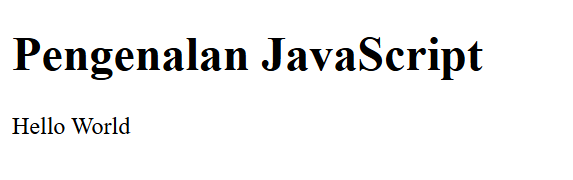
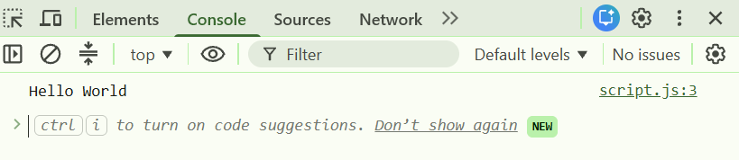

### Latihan 2 — Alert dan Prompt
**Langkah:** Program meminta nama pengguna melalui `prompt()`. Jika nama diisi, program menampilkan sapaan melalui `alert()` dan mengubah teks halaman. Jika kosong atau dibatalkan, program menampilkan pemberitahuan.

**Hasil:** Nama yang dimasukkan digunakan dalam pesan sapaan. Jika tidak ada nama, muncul pesan bahwa nama belum diisi.

**Penjelasan:** `prompt()` menerima input pengguna dan `alert()` menampilkan pesan dialog.

script.js
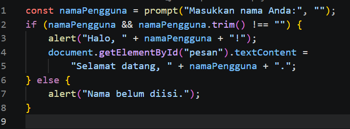

hasil
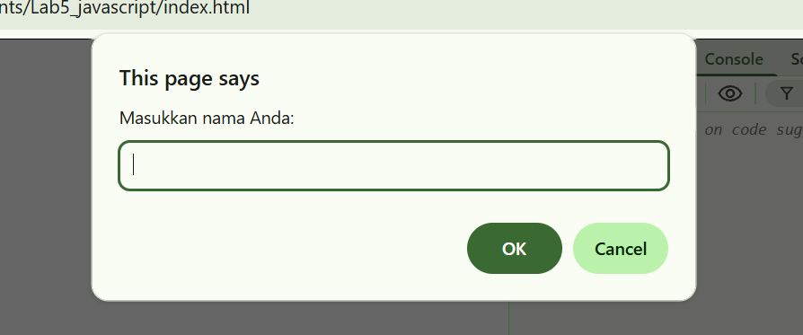

### Latihan 3 — Function dan Operasi Aritmetika
**Langkah:** Function `operasiDasar(a, b)` menjalankan penjumlahan, pengurangan, perkalian, pembagian, dan modulus. Program diuji menggunakan angka 9 dan 4.

**Hasil:**
- Penjumlahan: 13
- Pengurangan: 5
- Perkalian: 36
- Pembagian: 2,25
- Modulus/sisa bagi: 1

**Penjelasan:** Function membantu mengelompokkan perintah. Parameter `a` dan `b` menerima nilai yang akan dihitung.

script.js
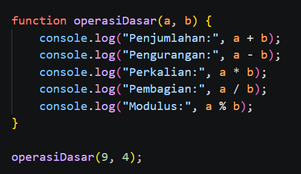

hasil
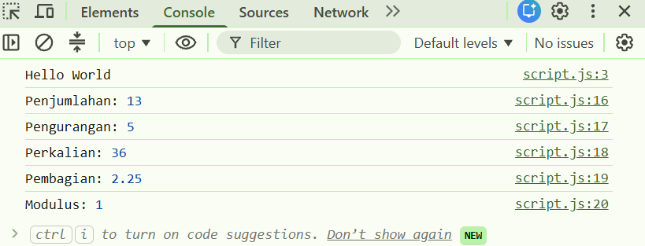

### Latihan 4 — Percabangan If–Else
**Langkah:** Program meminta nilai 0–100, mengubah masukan menjadi angka, lalu memeriksa apakah masukan valid. Nilai minimal 60 dinyatakan lulus.

**Hasil:** Nilai 60–100 menampilkan “Lulus”, nilai di bawah 60 menampilkan “Belum lulus”, sedangkan masukan kosong atau di luar rentang menampilkan pesan input tidak valid.

**Penjelasan:** `if-else` menjalankan perintah yang berbeda berdasarkan kondisi yang terpenuhi.

script.js
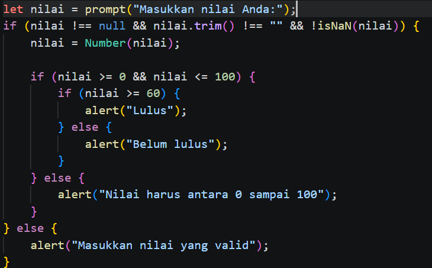

hasil
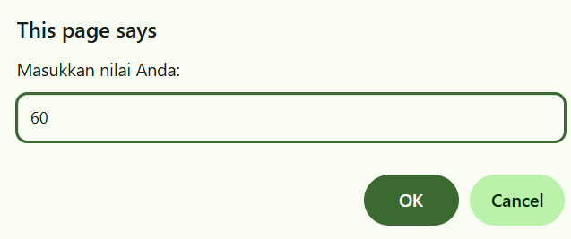
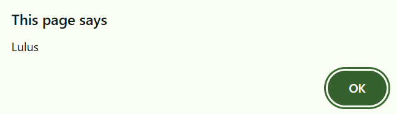

### Latihan 5 — Percabangan Switch
**Langkah:** Program meminta angka 1–5, kemudian menggunakan `switch` untuk menampilkan nama bilangan.

**Hasil:** Input 1 menampilkan “Bilangan satu”, input 2 menampilkan “Bilangan dua”, dan seterusnya sampai 5. Input selain itu menampilkan “Pilihan tidak tersedia”.

**Penjelasan:** `switch` memilih satu tindakan berdasarkan nilai yang cocok dengan salah satu `case`. `break` menghentikan proses pada case yang dipilih.

script.js


hasil
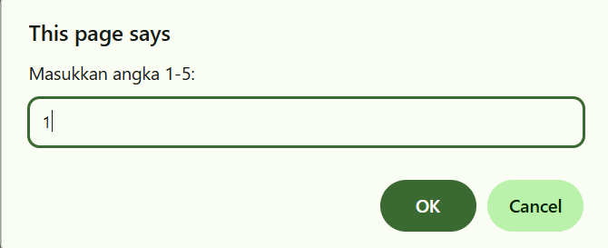
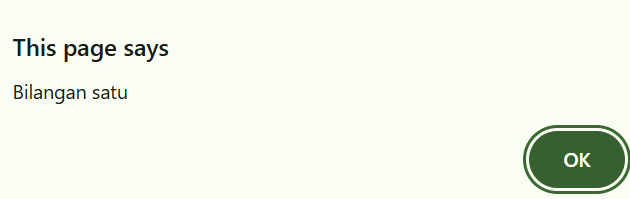

### Latihan 6 — Form Bilangan Genap atau Ganjil
**Langkah:** Pengguna memasukkan bilangan bulat, lalu menekan tombol Periksa. Program memvalidasi input dan menggunakan operator modulus untuk menentukan jenis bilangan.

**Hasil:** Bilangan yang habis dibagi dua dinyatakan genap, sedangkan bilangan bulat lainnya dinyatakan ganjil. Input kosong atau desimal ditolak. Nol termasuk bilangan genap.

**Penjelasan:** Operator `%` menghasilkan sisa pembagian. Jika `angka % 2 === 0`, bilangan tersebut genap.

index.html
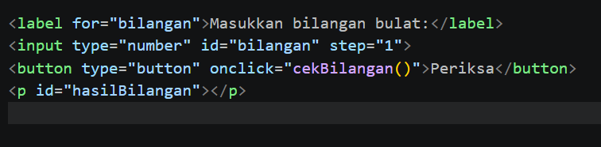

script.js
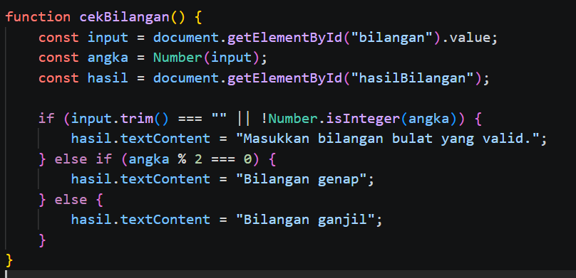

hasil 
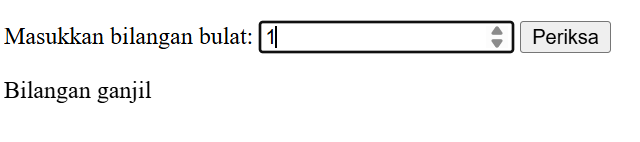
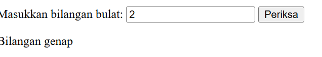

### Latihan 7 — Mengubah Warna Halaman
**Langkah:** Tiga tombol disediakan untuk mengubah warna latar menjadi hijau muda, putih, atau kuning muda. Semua tombol menggunakan function `ubahWarnaLatar(warna)` dengan parameter warna.

**Hasil:** Warna latar halaman berubah sesuai tombol yang ditekan.

**Penjelasan:** JavaScript dapat mengubah CSS melalui properti `document.body.style.backgroundColor`.

index.html
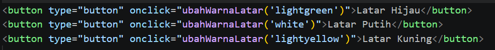

script.js
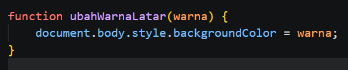

hasil
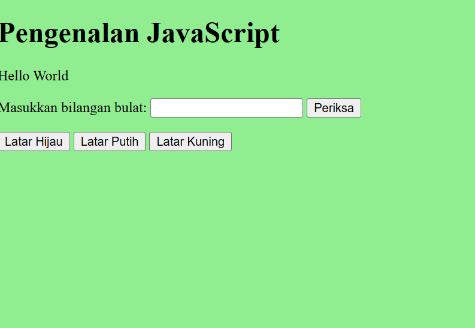

### Latihan 8 — DOM dan Checkbox Menu Makanan
**Langkah:** Pengguna memilih menu melalui checkbox. Setiap perubahan pilihan memanggil function untuk menghitung ulang total harga.

**Hasil:** Total harga berubah otomatis sesuai pilihan:
- Ayam goreng: Rp5.000
- Tempe: Rp500
- Telur dadar: Rp2.500
- Semua menu dipilih: Rp8.000

**Penjelasan:** `querySelectorAll()` memilih semua checkbox menu, `addEventListener()` mendeteksi perubahan pilihan, dan `textContent` menampilkan total harga.

index.html


script.js
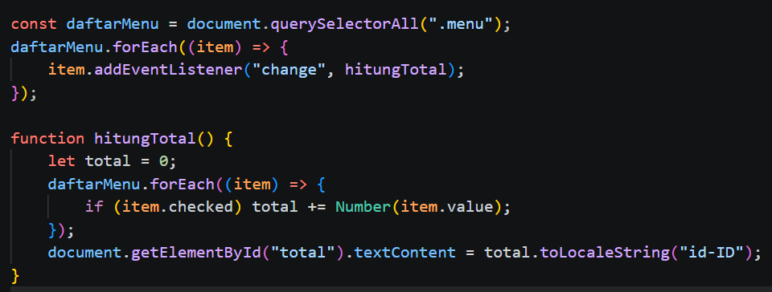

hasil
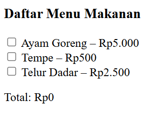

## E. Mini Project — Kalkulator Nilai Mahasiswa
**Langkah:** Nilai akhir dihitung dari 30% nilai tugas, 30% UTS, dan 40% UAS. Selanjutnya program menentukan predikat dan status kelulusan.

**Contoh pengujian berdasarkan data modul:**
- Tugas = 85
- UTS = 78
- UAS = 88
- Perhitungan: (85 × 0,30) + (78 × 0,30) + (88 × 0,40) = 83,50
- Predikat: B
- Status: Lulus

**Penjelasan:** Function `hitungNilaiAkhir()` memisahkan perhitungan nilai, sedangkan `tentukanPredikat()` menentukan huruf mutu berdasarkan nilai akhir. Status lulus diberikan jika nilai akhir minimal 60.

index.html
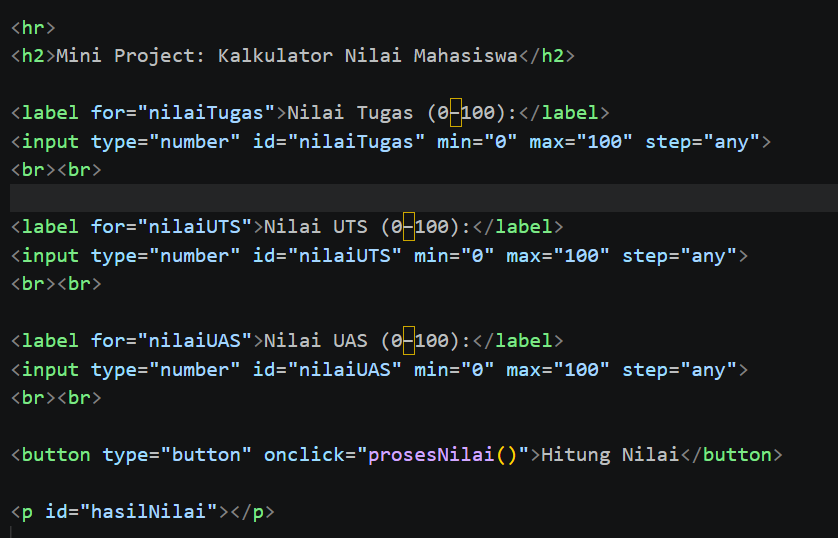

script.js
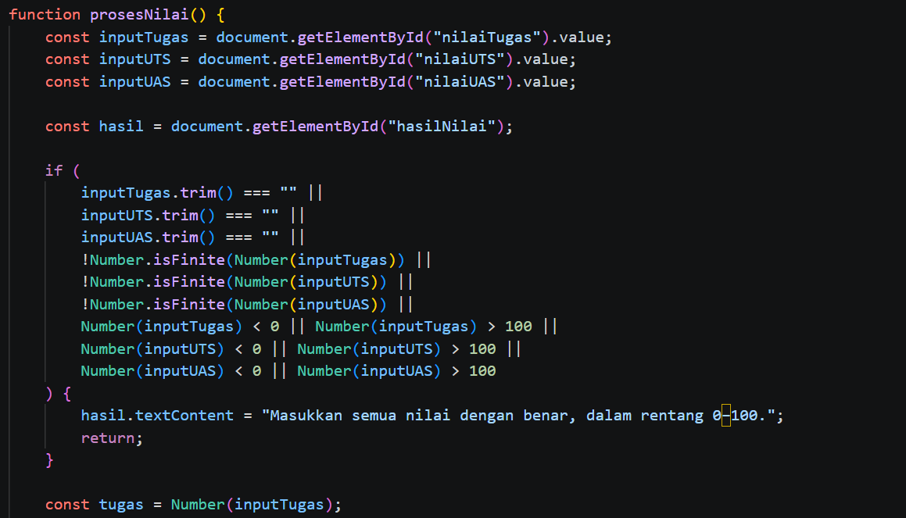

hasil
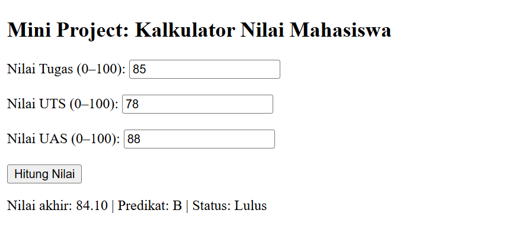

**Hasil Akhir**
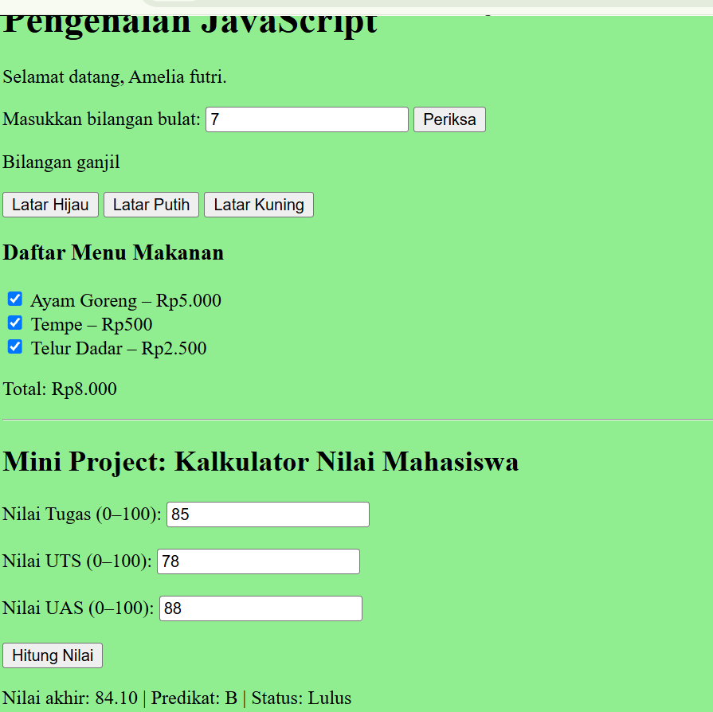

## F. Jawaban Pertanyaan dan Tugas

### 1. Jelaskan perbedaan `console.log()`, `alert()`, `prompt()`, dan `textContent`/`innerHTML`.
- `console.log()` menampilkan informasi di Console browser dan biasanya digunakan untuk pemeriksaan program.
- `alert()` menampilkan kotak dialog berisi pesan.
- `prompt()` menampilkan dialog yang meminta pengguna memasukkan teks.
- `textContent` mengubah atau mengambil teks biasa di dalam elemen HTML.
- `innerHTML` mengubah atau mengambil isi HTML di dalam elemen, termasuk tag HTML.

### 2. Apa perbedaan `let` dan `const`? Berikan contoh.
`let` digunakan jika nilai variabel akan diubah, sedangkan `const` digunakan jika variabel tidak akan ditetapkan ulang.

Contoh:
- `let umur = 19;` lalu `umur = 20;` diperbolehkan.
- `const nama = "Amelia";` lalu mencoba `nama = "Ani";` akan menghasilkan error karena variabel `const` tidak dapat ditetapkan ulang.

### 3. Apa perbedaan operator `==` dan `===`?
Operator `==` membandingkan nilai dengan kemungkinan konversi tipe data, sedangkan `===` membandingkan nilai sekaligus tipe datanya.

Contoh: `5 == "5"` menghasilkan `true`, sedangkan `5 === "5"` menghasilkan `false`.

### 4. Jelaskan fungsi `if–else` dan `switch`. Kapan masing-masing dapat digunakan?
`if–else` digunakan untuk memeriksa kondisi logis, termasuk kondisi berupa rentang nilai, misalnya menentukan kelulusan berdasarkan nilai minimal 60. `switch` digunakan ketika satu nilai dibandingkan dengan beberapa pilihan tertentu, misalnya memilih nama bilangan dari input 1 sampai 5.

### 5. Apa fungsi parameter dan `return` dalam function?
Parameter adalah tempat menerima data yang diberikan saat function dipanggil. `return` mengembalikan hasil dari function kepada bagian program yang memanggilnya.

Contoh: pada `function hitungLuas(panjang, lebar) { return panjang * lebar; }`, `panjang` dan `lebar` adalah parameter, sedangkan `return` mengembalikan hasil perkalian.

### 6. Bagaimana JavaScript memilih elemen HTML menggunakan `document.getElementById()`?
Metode `document.getElementById("pesan")` mencari elemen HTML yang memiliki atribut `id="pesan"`. Setelah elemen ditemukan, JavaScript dapat membaca atau mengubah teks, gaya, dan properti elemen tersebut.

### 7. Buat script untuk memvalidasi form agar nama tidak kosong dan nilai berada pada rentang 0–100.
Contoh script validasi:

```javascript
function validasiForm() {
  const nama = document.getElementById("nama").value.trim();
  const inputNilai = document.getElementById("nilai").value;
  const nilai = Number(inputNilai);

  if (nama === "") {
    alert("Nama tidak boleh kosong.");
    return false;
  }

  if (
    inputNilai.trim() === "" ||
    !Number.isFinite(nilai) ||
    nilai < 0 ||
    nilai > 100
  ) {
    alert("Nilai harus berada pada rentang 0–100.");
    return false;
  }

  alert("Data valid.");
  return true;
}
```

Contoh elemen form yang diperlukan:

```html
<form onsubmit="return validasiForm()">
  <label for="nama">Nama:</label>
  <input type="text" id="nama">

  <label for="nilai">Nilai:</label>
  <input type="number" id="nilai" min="0" max="100">

  <button type="submit">Kirim</button>
</form>
```

## G. Kesimpulan
Praktikum ini memperkenalkan penggunaan JavaScript untuk menampilkan output, menerima input, melakukan perhitungan, memilih tindakan berdasarkan kondisi, menjalankan perulangan, serta memanipulasi elemen HTML melalui DOM. Dari latihan dan mini project, dapat dipahami bahwa JavaScript membuat halaman web lebih interaktif dan dapat membantu memvalidasi masukan pengguna.


